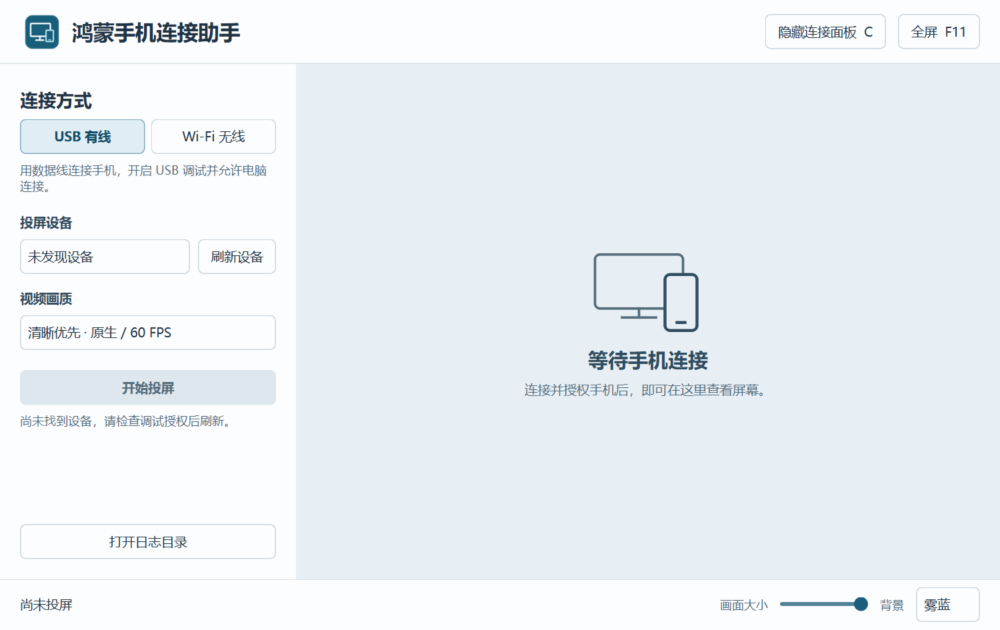

# 鸿蒙手机连接助手 · HarmonyCast

在 Windows 上通过 USB 或 Wi-Fi 查看鸿蒙手机的实时屏幕。支持选择设备、切换画质和全屏观看，操作和声音保留在手机端。适用于支持 HDC 调试和屏幕采集的鸿蒙手机，以及 Windows 10 1809 或更新版本的 x64 电脑。



## 使用说明

1. **启动**　运行通用版安装包 `HarmonyCast-Setup-1.0.0-x64.exe`，从开始菜单打开「鸿蒙手机连接助手」。
2. **USB 投屏**　用数据线连接手机，开启 USB 调试并允许电脑连接。启动时只检测到一台已授权的 USB 手机会自动投屏。稍后插线或有多台手机时，点击「刷新设备」，选中手机后点「开始投屏」。
3. **Wi-Fi 投屏**　手机和电脑接入同一局域网，手机开启无线调试。在「Wi-Fi 无线」中填写手机显示的 `IP:端口`，点「连接并投屏」。也可先连一台已授权的 USB 手机，刷新设备后点「通过 USB 获取无线地址」开启 5555 端口。无线画面出现后即可拔线。
4. **观看**　`F11` 切换全屏，`Esc` 退出，`C` 收起或展开连接面板。停止投屏后可以更换画质。无线连接超时时，请核对端口，确认代理或 VPN 允许手机 IP 直连。详细错误可在「打开日志目录」中查看。

USB 已有华为畅享 90 Plus（HarmonyOS 7.0.0.111）与 Windows 11 的真机记录。Wi-Fi 通过本地模拟连接和视频预览验证，尚待真机验证。

## 从源码运行

准备 Python 3.13 和 JDK 21，将 `JAVA_HOME` 指向 JDK，在仓库根目录运行：

```powershell
python -m venv .venv
.\.venv\Scripts\python.exe -m pip install -r requirements.txt
.\build.ps1 -BridgeOnly
.\.venv\Scripts\python.exe main.py
```

制作安装包时，先在虚拟环境安装 `pyinstaller`，再运行 `.\build-installer.ps1`，产物位于 `release\`。

`main` 维护通用版。原比赛页面和素材见[肌智演示分支](https://github.com/zhiwuyazhe-fjr/harmony-cast-windows/tree/codex/jixfit-demo)。依赖来源见[第三方组件说明](THIRD_PARTY_NOTICES.md)。
